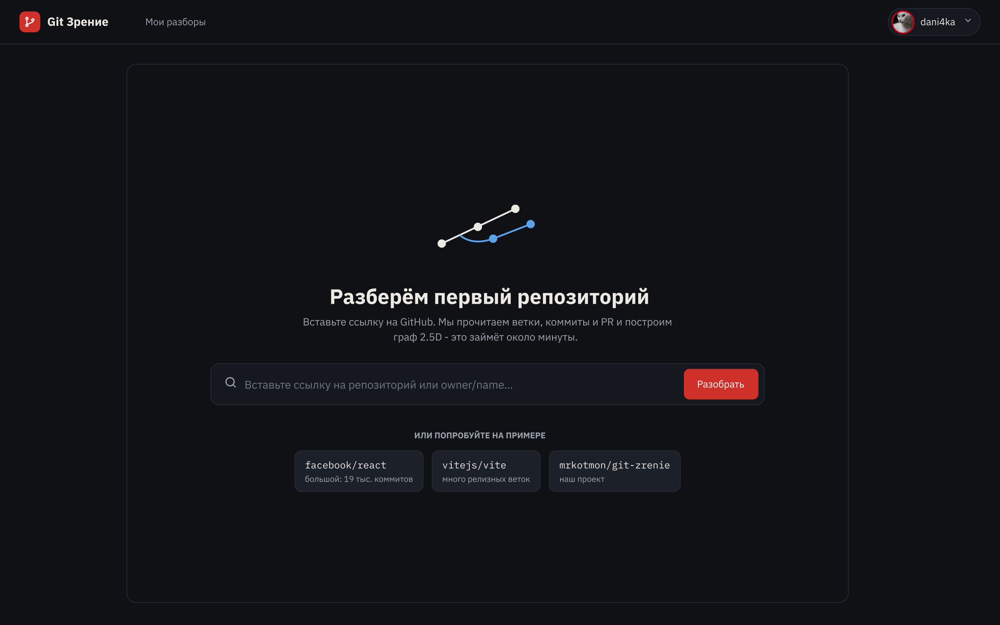
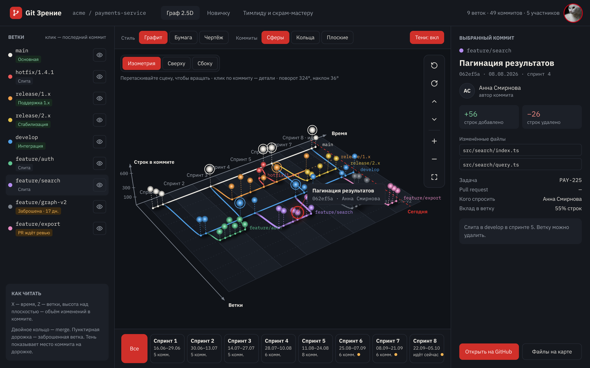
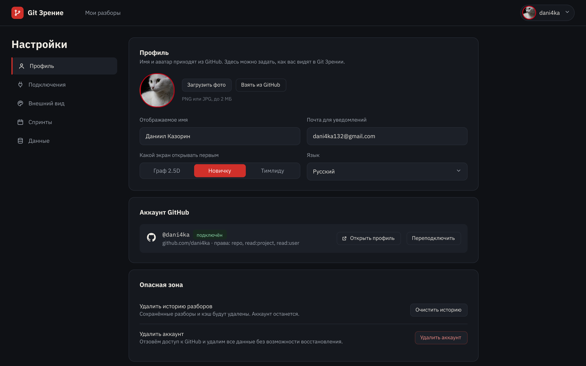
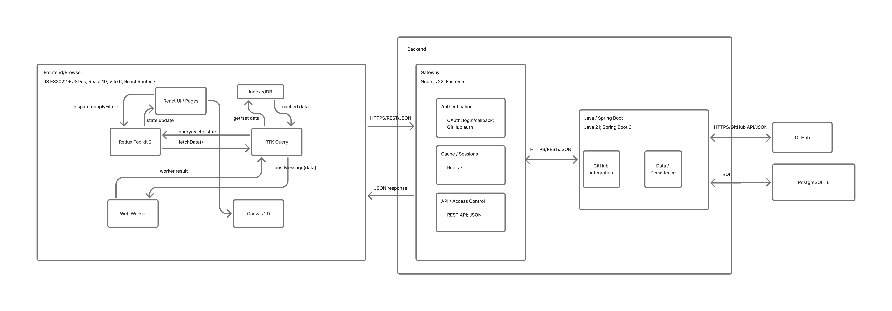
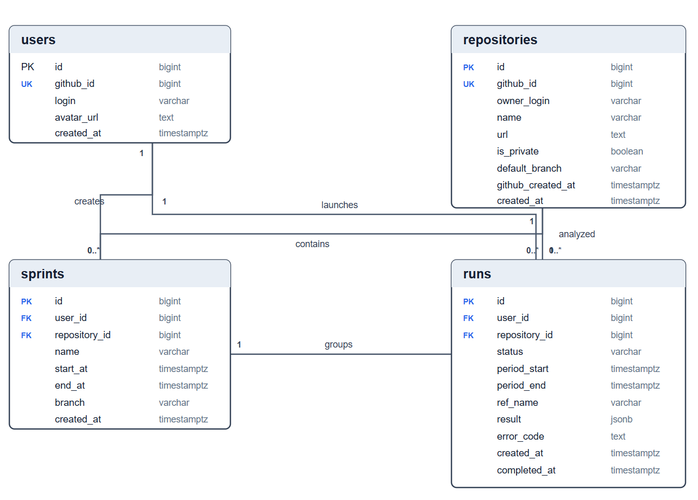

# Git Зрение

> Понять чужой репозиторий за час, а не за неделю. Видеть состояние команды и спринта, не открывая консоль.

**Git Зрение** — веб-сервис, который по ссылке на GitHub-репозиторий строит интерактивную 2.5D-карту веток и коммитов и собирает из истории то, что обычно узнают неделями: как устроены версионные ветки, что читать первым, кто владеет кодом, где застряли PR и задачи спринта.

**Сайт:** https://mrkotmon.github.io/git-zrenie/ (обновляется автоматически после каждого merge в `main`).

Курсовой проект по дисциплине «Веб-приложения», ИТМО, 2026/27 · проект №14 в [projects.json](https://github.com/stepancar-web-programming/readme/blob/master/projects.json).

---

## Проблема

**Новому разработчику.** В рабочем репозитории десятки веток: `main`, `develop`, `release/1.x`, `release/2.x`, hotfix-и, фичи. Какая из них живая, куда делать PR, какие файлы — каркас, а какие лучше не трогать, кого спросить про модуль — всё это узнаётся неделями из чатов и `git log`.

**Тимлиду и скрам-мастеру.** Консоль и GitHub показывают коммиты, но не отвечают на вопросы спринта: какие ветки заброшены, какие PR ждут ревью, у каких задач статус «в работе», а кода нет, на ком держится ревью, какой модуль знает только один человек.

## Решение

Один движок анализа истории и две линзы поверх него.

| Для кого | Что даёт |
| --- | --- |
| **Новичок** | Карта веток с ролями (feature → develop → release → main), маршрут чтения файлов, «кого спросить» по каждому модулю, хронология релизов |
| **Тимлид / скрам-мастер** | Проблемные и заброшенные ветки, PR без ревью, задачи спринта без кода, распределение нагрузки, заготовка к ретроспективе |
| **Оба** | Интерактивный 2.5D-граф: время × ветки × объём изменений, вращение, стили, фильтр по спринтам, детали коммита по клику |

## Что уже работает

| Функция | Где посмотреть | Статус |
| --- | --- | --- |
| Лендинг и проверка ссылки на репозиторий | сайт | готово |
| Страница репозитория: коммиты из GitHub API, графики по дням и по авторам на Canvas, детали коммита | сайт | готово |
| Вход через GitHub, пользователь сохраняется в PostgreSQL | локально | готово |
| Меню пользователя и страница «Мои разборы» | локально | готово |
| Интерфейс страницы графа 2.5D | сайт | готово, сам граф на G5 |
| Автодеплой на GitHub Pages, мониторинг ошибок в Sentry | сайт | готово |
| Запуск всего проекта через `make run` | | в работе |
| История разборов на сервере, линзы новичка и тимлида, настройки | | G5 |

Страница репозитория работает и на GitHub Pages: публичные репозитории читаются напрямую из GitHub API. Для входа нужен сервер, поэтому пока он работает только при локальном запуске.

## Макеты

Figma: https://www.figma.com/design/0cewODosFvpQXMtYZBgfpq/Untitled?node-id=0-1&t=9ZgASI9YIkHCZdVG-1

### Поиск


### Граф 2.5D


### Настройки


### Остальное
Больше макетов находится в [docs/mockups.md](docs/mockups.md)

## Архитектура

[Figma](https://www.figma.com/board/lH1c6Etjb7ea3BNJ9L82lN/Git-zrenie-architecture?node-id=0-1&t=I73SBjnQQUOJOoLh-1)



**Отличие от схемы на G4.** Java-сервиса пока нет, поэтому Node-шлюз сам работает с PostgreSQL и с GitHub при входе. Сессия хранится в подписанной cookie, Redis не используется. На G5 работа с данными и с GitHub API переходит в Java-сервис, а шлюз будет обращаться к нему по HTTP. Код шлюза для этого разделён: запросы к базе собраны в одном файле `server/src/users.js`.

## Стек

| Слой | Технологии | Зачем | Сейчас |
| --- | --- | --- | --- |
| Язык | **JavaScript** (ES2022) + JSDoc | контракты проверяются в рантайме | используется |
| Frontend | React 19, Vite 8, React Router 7 | быстрая сборка | используется |
| Состояние | Redux Toolkit 2 | предсказуемые срезы, DevTools | используется |
| UI | MUI 9 | доступные компоненты, тёмная тема | используется |
| Визуализация | Canvas 2D API | тысячи узлов, ручная 2.5D-проекция | графики коммитов, граф на G5 |
| Вычисления | Web Worker | анализ 10 000+ коммитов без блокировки интерфейса | G5 |
| Кэш, PWA | IndexedDB (`idb`), `vite-plugin-pwa` | открытие разбора без сети | по желанию |
| Шлюз | Node.js 24, Fastify 5 | вход через GitHub, сессии, проксирование | используется |
| Анализ | Java 21, Spring Boot 3, JGit | клонирование, история, GitHub API | G5 |
| Хранилища | PostgreSQL 16 | пользователи и история разборов | используется, локально PGlite |
| Тесты | Vitest, Testing Library, Playwright, MSW | unit, компоненты, e2e, моки | используется |
| Качество | ESLint 10, Prettier | линтеры по требованию методички | используется |
| Мониторинг | Sentry, Яндекс Метрика | ошибки и аналитика | Sentry, Метрика на G5 |
| Инфраструктура | Docker Compose, GitHub Actions, GitHub Pages | `make run`, CI, деплой | CI и деплой |

## База данных

Проект использует **PostgreSQL 16**. Таблицы создаются из [`database/initialBd.sql`](database/initialBd.sql) при первом запуске сервера. Если в `server/.env` задан `DATABASE_URL`, сервер подключается к нему (например, к PostgreSQL в Docker). Если нет, используется встроенный PostgreSQL (PGlite): данные лежат в папке `server/.data`, ставить ничего не нужно.

### Схема данных



Таблица `sprints` появится на G5, в текущем SQL её нет.

### Таблицы

| Таблица | Основные поля | Назначение |
|---------|---------------|------------|
| `users` | `id`, `github_id` (unique), `login`, `avatar_url`, `created_at` | Учёт пользователя после входа через GitHub |
| `repositories` | `id`, `github_id` (unique), `owner_login`, `name`, `url`, `is_private`, `default_branch` | Общая запись о репозитории |
| `runs` | `id`, `user_id`, `repository_id`, `status`, `period_start`, `period_end`, `ref_name`, `result`, `created_at` | Один запуск анализа и его результат |
| `sprints` (G5) | `id`, `user_id`, `repository_id`, `name`, `start_at`, `end_at`, `branch`, `created_at` | Именованный период для анализа коммитов |

### Авторизация и привязка к БД

Вход через **GitHub OAuth**. Пароль в базе не хранится, пользователя находим по `github_id`: логин на GitHub можно сменить, а id нет.

Поток входа:
1. Пользователь нажимает «Войти через GitHub» на странице `/login`.
2. Сервер перенаправляет на GitHub и запоминает случайный `state` в cookie.
3. После подтверждения GitHub возвращает пользователя на `/login?code=...&state=...`.
4. Страница отправляет `code` и `state` на `POST /api/auth/github/callback`.
5. Сервер сверяет `state`, обменивает код на профиль GitHub, создаёт или обновляет строку в `users` и ставит подписанную httpOnly-cookie сессии. Токен GitHub не сохраняется.
6. При следующих посещениях сайт проверяет сессию через `GET /api/auth/me`, выход через `POST /api/auth/logout`.

## Команда

| Участник | Роль | Зона ответственности |
| --- | --- | --- |
| Казорин Даниил | Dev 1 · Frontend & UI | макеты, лендинг, страница графа, настройки, линза новичка |
| Немыкин Ярослав | Dev 2 · Данные пользователя | страница входа, меню пользователя, база данных, Docker Compose, история разборов, линза тимлида |
| Павлов Руслан | Dev 3 · Backend, DevOps & QA | сервер и вход, страница репозитория, граф на Canvas, CI, деплой, мониторинг |

Задачи и сроки: [доска проекта](https://github.com/users/mrkotmon/projects/3)

## Запуск

Нужен Node.js 24.

### Только сайт

```bash
cd client
npm ci
npm run dev            # http://localhost:5173
```

Без сервера страница входа работает на моках (MSW), страница репозитория берёт данные из GitHub API.

### Сайт и сервер со входом через GitHub

1. Создать OAuth App: GitHub → Settings → Developer settings → OAuth Apps → New OAuth App.
   Homepage URL `http://localhost:5173`, Authorization callback URL `http://localhost:5173/login`.
2. Запустить сервер:

   ```bash
   cd server
   cp .env.example .env   # на Windows: copy .env.example .env
   # вписать в .env GITHUB_CLIENT_ID, GITHUB_CLIENT_SECRET, SESSION_SECRET
   npm ci
   npm run dev            # http://localhost:3001
   ```

3. Создать файл `client/.env.local` со строкой `VITE_USE_MOCKS=false`, чтобы запросы `/api` шли на сервер, а не в моки. Затем в отдельном терминале:

   ```bash
   cd client
   npm run dev
   ```

Ключи OAuth App и `.env` в репозиторий не попадают. Каждый участник создаёт свой OAuth App или получает ключи лично.

### Проверки

Те же, что запускает CI:

```bash
cd client
npm run lint
npm run format:check
npm run test:coverage
npm run test:e2e

cd ../server
npm run lint
npm run format:check
npm run test:coverage
```

### Через Docker

`make run` с PostgreSQL в Docker Compose в работе (задача P3.7).

## Структура репозитория

```
├── client/            # фронтенд: React, Vite, тесты
├── server/            # сервер: Fastify, вход через GitHub, сессии
├── database/          # SQL-схема PostgreSQL
├── docs/              # документация, схемы, макеты
│   └── img/           # скриншоты макетов и схем
├── .github/workflows/ # CI и автодеплой
└── README.md
```

## Как мы работаем

GitHub Flow: короткие ветки от `main`, PR с ревью, прямые коммиты в `main` запрещены. PR нельзя слить, пока не пройдут проверки `lint`, `unit`, `e2e` и `server`. Подробно: [docs/Contributing.md](docs/Contributing.md) и [docs/git-workflow.md](docs/git-workflow.md).

## Лицензия

MIT
